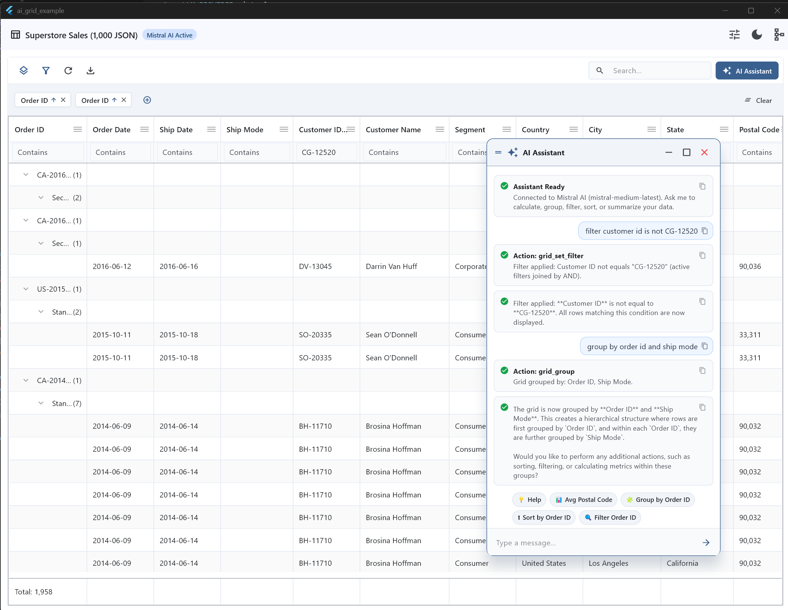

# AI Grid (`ai_grid`)

[](https://pub.dev/packages/ai_grid)
[](https://opensource.org/licenses/MIT)
[](https://flutter.dev)
[](https://flutter.dev/to/wasm)

**AI Grid** is an intelligent, high-performance DataGrid for Flutter that bridges enterprise tabular virtualization with native AI assistant controls and Model Context Protocol (MCP) tool execution.



* **Grid Engine**: Powered by **[fitgrid_table](https://pub.dev/packages/fitgrid_table)** — measuring your content instead of guessing widths, painting cells via direct canvas rendering (~3ms frame times on 1M rows), sticky hierarchical row grouping, isolate multi-sort, and summary footers.
* **AI Agent & Tool Orchestration**: Powered by **[dart_mcp_core](https://pub.dev/packages/dart_mcp_core)** — exposing structured MCP local tools for real-time schema introspection, precise in-engine math calculations, multi-column filtering, and natural language table operations.

---

## ✨ Key Features

### 1. ⚡ High-Performance Canvas DataGrid
* **Direct Canvas Rendering**: Cells are painted directly to the canvas rather than building hundreds of individual widgets, delivering consistent 60/120 FPS scrolling even over 1,000,000 rows.
* **Content-Based Auto-Sizing**: Automatically measures content to fit columns without manual pixel width calculations.
* **Hierarchical Row Grouping**: Drag-and-drop column headers or trigger grouping programmatically with aggregate rollups.
* **Multi-Column Sorting**: Prioritized multi-column sorting with background isolate execution for massive datasets.
* **Inline Column Filtering**: Individual column filter row supporting contains, equals, starts with, ends with, and comparison operators.
* **Aggregate Footers**: Auto-computed sum, average, min, max, and count summary rows.

### 2. 🧠 Native AI Assistant & Model Context Protocol (MCP)
* **Embedded AI Chat**: Conversational interface that understands your tabular schema, column types, and data distributions.
* **Hallucination-Free Math Engine (`grid_calculate`)**: Calculations (sum, average, minimum, maximum, count, median) are executed strictly inside the Dart engine—ensuring 100% mathematical accuracy without LLM arithmetic errors.
* **Multi-Column AND Filtering**: Seamlessly parses and applies complex queries across multiple columns simultaneously (e.g. *"filter region East and category Furniture"*).
* **Negative Filtering**: Supports `not equals` and `does not contain` operators (e.g. *"Category not Furniture"*, *"exclude South"*).
* **Context-Aware Suggestions**: Proactive quick-action chips generated dynamically based on active columns.
* **LLM Provider Agnostic**: Connects seamlessly with Mistral, OpenAI, Anthropic Claude, Google Gemini, Ollama, custom OpenAI-compatible endpoints, or built-in local heuristics.

### 3. 💾 Save & Restore Grid Settings (Auto-Save)
* **Full State Persistence**: Export or restore grid configuration including:
  * `visibleColumns` & `hiddenColumns`
  * `groupColumns` (hierarchical row grouping)
  * `sorts` (multi-column priority, field, direction)
  * `filters` (field, operator, target value)
  * `showColumnFilterRow` (inline filter header visibility)
* **Automatic Layout Restoration (`autoSave`)**: Pass `autoSave: true` and a `persistenceKey` to automatically persist all user layout changes and restore them on startup.
* **JSON Import/Export**: Export settings to JSON string or save to file via `controller.exportSettingsJson()` and restore via `controller.restoreSettingsJson(str)`.
* **In-Memory Cache**: Built-in `AiGridSettingsStorage` handles session-level caching and retrieval.

### 4. 📋 Copy-to-Clipboard in AI Assistant
* **Prompt Bubbles**: 1-tap copy button on every user message bubble.
* **AI Responses**: Copy button in the header of each assistant response card to copy the full AI response and execution summary directly to the system clipboard.

### 5. 📱 Responsive Desktop & Mobile Layouts
* **Desktop Mode (≥ 620px)**:
  * Floatable, moveable, and resizable AI Assistant window powered by [`draggable_overlay_window`](https://pub.dev/packages/draggable_overlay_window).
  * 8-directional edge/corner resizing, drag-by-header, minimize, maximize, and smooth focus management.
* **Mobile Mode (< 620px)**:
  * Dynamic, non-overflowing toolbar with action menus collapsed into a sleek `PopupMenuButton` dropdown.
  * Auto-flexing search bar that adapts to any screen width without pixel overflows.
  * Instant 1-tap Mode Switcher tab bar (`[ 📊 Data Grid ]` | `[ ✨ AI Assistant ]`).
  * Full-screen mobile assistant view with quick `[← Back to Data Grid]` navigation.
### 6. ↔️ Interactive Column Resizing & Width Policies
* **Drag-to-Resize**: Hovering between column headers reveals draggable divider handles to interactively adjust column widths.
* **Auto-Fit on Double-Click**: Double-clicking any column divider handle or choosing "Size to fit" in the column menu auto-fits the column to its actual cell content.
* **Flexible Sizing Policies**: Configure `columnWidth` with any policy from [fitgrid_table](https://pub.dev/packages/fitgrid_table#column-widths):
  * `FitGridColumnWidth.auto(min: 80, max: 300)` — dynamic content-based measurement.
  * `FitGridColumnWidth.fixed(120)` — pinned exact pixel width.
  * `FitGridColumnWidth.flex(1, min: 140)` — proportional flex share of remaining grid width.
  * `FitGridColumnWidth.fitHeader(min: 44)` — sized strictly to the header label.
* **Layout Persistence**: Custom column widths automatically persist across app restarts when `autoSave: true` is enabled.

### 7. 📤 Fast & Pure-Dart Excel (.xlsx) Export
* One-click **Export to Excel** directly accessible via the toolbar download button, mobile menu, or natural language AI command (`export`):
  * **Native Save As Dialog**: Opens the platform's native "Save As..." dialog (`FileSaver.instance.saveAs`) allowing the user to select the destination folder and filename across Web, Desktop (Windows, macOS, Linux), and Mobile (Android, iOS).
  * **Pure-Dart Excel Engine**: Generates `.xlsx` workbooks directly in Dart with zero C/C++ native dependencies or platform channels.
  * **Direct Programmatic API**: Trigger export programmatically anytime via `controller.export()`.

### 8. 📄 Pagination & Partial Data Load (Client-Side & Server-Side)
* **Client-Side Pagination**: Simple opt-in via `enablePagination: true` and `pageSize: 25`, rendering an interactive page-navigation footer with total row counts and page controls.
* **Server-Side Partial Data Load (`LazyAiGridDataSource`)**:
  * Only requests and loads the slice of records for the active page from your backend or REST/GraphQL API.
  * Dynamically passes current page, page size, active column sorting, and active filter criteria to your `fetch` callback.

### 9. 🌐 WebAssembly (WASM) Compatible
* Fully verified with Flutter WebAssembly (`dart2wasm`).
* Zero direct dependencies on legacy `dart:html`.
* Native filesystem operations are cleanly isolated behind conditional imports, ensuring zero runtime or compile-time breakages in browser WASM environments.

### 10. 🎨 Modern Adaptive Theming
* Harmonious styling that automatically reflects the parent application's Material 3 `ThemeData` across Light and Dark modes.

---

## 🛠️ MCP Tool Reference

`ai_grid` exposes 16 specialized MCP tools through `AiGridSkill`:

| Tool Name | Description |
| :--- | :--- |
| `grid_get_schema` | Returns column field names, titles, types, and capability flags. |
| `grid_get_state` | Returns active grouping, active filters, sorting, search query, row count, and visibility. |
| `grid_get_sample_data` | Retrieves real sample rows (1–10 rows) for contextual reasoning. |
| `grid_calculate` | **Calculates exact metrics** (sum, average, min, max, count, median) in Dart without LLM math errors. |
| `grid_set_filter` | Applies single or multi-column filters joined by AND, including negative operators. |
| `grid_clear_filters` | Clears all or specified column filters. |
| `grid_sort` | Applies single or multi-column sorting with ascending/descending directions. |
| `grid_group` | Sets hierarchical row grouping fields. |
| `grid_set_column_visibility` | Shows or hides specific columns. |
| `grid_search` | Applies global tabular text search. |
| `export` | **Exports table data to Excel (.xlsx)** using FitGrid and opens the native Save As... dialog to select output directory and filename. Works on Web, Desktop, and Mobile. |
| `grid_export` | Exports grid data to XLSX, CSV, TSV, or JSON and downloads/saves the file. |
| `grid_go_to_page` | Navigates pagination to a specific page or relative direction ("next", "previous", "first", "last"). |
| `grid_get_pagination_status` | Returns active pagination status (current page, total pages, page size, isPaginated). |
| `grid_export_settings` | Exports current grid settings (visible columns, grouping, sorts, filters) as a JSON string. |
| `grid_restore_settings` | Restores grid settings from a JSON string or settings object. |
| `grid_reset` | Resets grouping, filters, sorting, search, and restores all column visibility. |

---

## 🚀 Getting Started

### Installation

Add `ai_grid` to your `pubspec.yaml`:

```yaml
dependencies:
  ai_grid: ^0.0.3
  material_ui: ^1.4.0
```

*(Note for local development: If using local checkouts, path dependencies can be specified via dependency overrides).*

### Basic Usage

```dart
import 'package:flutter/material.dart';
import 'package:ai_grid/ai_grid.dart';

void main() => runApp(const MyApp());

class MyApp extends StatelessWidget {
  const MyApp({super.key});

  @override
  Widget build(BuildContext context) {
    return MaterialApp(
      theme: ThemeData.light(useMaterial3: true),
      darkTheme: ThemeData.dark(useMaterial3: true),
      home: const SalesGridPage(),
    );
  }
}

class SalesGridPage extends StatefulWidget {
  const SalesGridPage({super.key});

  @override
  State<SalesGridPage> createState() => _SalesGridPageState();
}

class _SalesGridPageState extends State<SalesGridPage> {
  late final AiGridController _controller;
  late final LocalAiGridDataSource _dataSource;

  @override
  void initState() {
    super.initState();
    _controller = AiGridController();

    final columns = [
      const AiGridColumn(
        field: 'orderId',
        title: 'Order ID',
        type: AiGridColumnType.text,
        aggregateType: AiGridAggregateType.count,
        width: 140,
      ),
      const AiGridColumn(
        field: 'customer',
        title: 'Customer Name',
        type: AiGridColumnType.text,
        width: 180,
      ),
      const AiGridColumn(
        field: 'category',
        title: 'Category',
        type: AiGridColumnType.text,
        width: 140,
      ),
      const AiGridColumn(
        field: 'sales',
        title: 'Sales Amount',
        type: AiGridColumnType.currency,
        aggregateType: AiGridAggregateType.sum,
        width: 140,
      ),
    ];

    final sampleData = [
      {'orderId': 'ORD-001', 'customer': 'Claire Gute', 'category': 'Furniture', 'sales': 261.96},
      {'orderId': 'ORD-002', 'customer': 'Brosina Hoffman', 'category': 'Technology', 'sales': 731.94},
      {'orderId': 'ORD-003', 'customer': 'Darrin Van Huff', 'category': 'Office Supplies', 'sales': 14.62},
    ];

    _dataSource = LocalAiGridDataSource(
      initialData: sampleData,
      columns: columns,
    );
  }

  @override
  void dispose() {
    _controller.dispose();
    super.dispose();
  }

  @override
  Widget build(BuildContext context) {
    return Scaffold(
      appBar: AppBar(title: const Text('Enterprise Sales Data')),
      body: AiGrid(
        dataSource: _dataSource,
        controller: _controller,
        enableAiAssistant: true,
      ),
    );
  }
}
```

---

## 🤖 Configuring the AI Assistant

Configure any LLM provider via `.env` or in code:

```dart
// Option 1: Load from .env
final config = await AiGridConfig.fromEnv();

// Option 2: Programmatic configuration
final config = AiGridConfig(
  llmConfig: LlmConfig(
    provider: LlmProvider.mistral, // or openai, anthropic, gemini, ollama
    apiKey: 'your_api_key_here',
    model: 'mistral-large-latest',
  ),
);

AiGrid(
  dataSource: dataSource,
  aiConfig: config,
);
```

### Supported `.env` Variables

Create a `.env` file in the root of your application or asset bundle:

```ini
# Provider: mistral | openai | anthropic (or claude) | gemini | ollama | openai_compatible
LLM_PROVIDER=mistral

# Model identifier
LLM_MODEL=mistral-medium-latest

# API Authentication Key (Optional for local Ollama / LM Studio)
LLM_API_KEY=your_api_key_here

# Base URL (Required for openai_compatible, custom proxy, or Ollama)
LLM_URL=https://api.mistral.ai/v1
```

#### Provider Configuration Examples

##### 1. Mistral AI
```ini
LLM_PROVIDER=mistral
LLM_MODEL=mistral-medium-latest
LLM_API_KEY=your_mistral_api_key
LLM_URL=https://api.mistral.ai/v1
```

##### 2. OpenAI
```ini
LLM_PROVIDER=openai
LLM_MODEL=gpt-4o-mini
LLM_API_KEY=sk-...
```

##### 3. Anthropic Claude
```ini
LLM_PROVIDER=anthropic
LLM_MODEL=claude-3-5-sonnet-20241022
LLM_API_KEY=sk-ant-...
```

##### 4. Google Gemini
```ini
LLM_PROVIDER=gemini
LLM_MODEL=gemini-1.5-flash
LLM_API_KEY=AIzaSy...
```

##### 5. Ollama (Local on localhost:11434)
```ini
LLM_PROVIDER=ollama
LLM_MODEL=llama3.1
LLM_URL=http://localhost:11434
```

##### 6. Custom OpenAI-Compatible (OpenRouter, Groq, Together, LM Studio, vLLM)
```ini
LLM_PROVIDER=openai_compatible
LLM_MODEL=meta-llama/llama-3.1-70b-instruct
LLM_API_KEY=your_custom_key_or_empty
LLM_URL=https://openrouter.ai/api/v1
```

---

## 📄 License

This project is licensed under the MIT License — see the [LICENSE](LICENSE) file for details.
